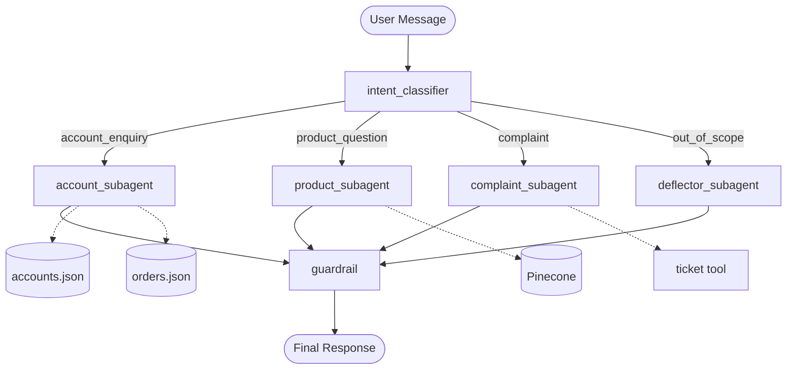

# TaskFlow — Multi-Agent Support Assistant with Guardrails

> A customer support agent that routes requests to specialist agents, answers product questions using retrieved documentation, protects PII, checks for unsupported answers, and escalates higher-severity complaints to a human.

> **TL;DR** — LangGraph multi-agent support assistant with four specialist routes, Pinecone-backed product retrieval, PII / hallucination / scope guardrails, human escalation, FastAPI backend, Streamlit UI, and Docker Compose. Evaluated manually on 30 queries: 86.7% intent routing accuracy, 100% PII redaction recall, 100% escalation correctness, 100% out-of-scope deflection, and 7.8s median latency.

Built with LangGraph, FastAPI, Pinecone, and Docker. The evaluation is a small, manually scored test set and should be interpreted as a portfolio evaluation, not a production reliability guarantee.

[](https://www.python.org/downloads/release/python-3120/)
[](https://github.com/langchain-ai/langgraph)
[](https://fastapi.tiangolo.com/)
[](https://docs.docker.com/compose/)
[](./LICENSE)

---

## What it does

- **Classifies intent** — routes user messages to one of four specialist subagents.
- **Calls tools** — performs account lookups, order-status checks, password resets, and ticket creation.
- **Grounds product answers** — retrieves relevant help documentation from a Pinecone-backed knowledge base.
- **Applies guardrails** — checks for PII, unsupported / ungrounded answers, and out-of-scope requests.
- **Escalates complaints** — creates a ticket and sets an escalation flag for high-severity cases.
- **Exposes execution traces** — the Streamlit UI displays routing, tool calls, and guardrail checks.

---

## Evaluation Results

I ran **30 test queries** across four intent categories and manually scored the outputs.

| Metric | Result | Evaluation basis |
|---|---:|---|
| Intent routing accuracy | **26/30 (86.7%)** | 30 labeled queries across four intents |
| PII redaction recall | **5/5 (100%)** | Five test queries containing embedded emails, names, or phone numbers |
| Escalation correctness | **5/5 (100%)** | Five complaints expected to escalate |
| Out-of-scope deflection | **7/7 (100%)** | Seven off-topic queries, including one prompt-injection attempt |
| Hallucination flag recall | **1/2 (50%)** | Two cases where retrieval / context was insufficient |
| Median response latency | **7.8s** | 30 requests; GPT-4o-mini; no streaming |

These are manually scored results on a small test set, not a statistically representative production benchmark.

### Evaluation findings and limitations

- **Intent routing:** Four cases were misclassified (workbook rows 11, 12, 13, and 22): payment methods, app crashes during login, plan upgrades, and subscription cancellation. The notes indicate ambiguity between account, product, billing, and complaint intents.
- **Escalation:** One app-crash query was routed as a complaint and escalated, although the evaluation notes suggest it should have been handled as a troubleshooting question. The five-of-five escalation score applies to the five queries labeled as expected escalations; it does not mean every escalation decision across all 30 queries was correct.
- **Hallucination flagging:** The README's detailed evaluation notes say the guardrail caught one of two ungrounded cases. The workbook summary calls the 0.5 value "precision", while the README table and case narrative call it "recall". This README uses **recall**, following the detailed case narrative; the workbook summary label should be corrected to match the chosen definition before treating it as a reproducible metric.
- **Latency:** Median latency was approximately 7.8 seconds. The current flow does not use streaming, and the test set shows slower responses for retrieval-backed product queries.

Full query set and scored results: [`tests/evals/results.csv`](./tests/evals/results.csv).

**How to reproduce:** `python tests/evals/run_eval.py` — evaluation queries and scoring code are in `tests/evals/`.

---

## Architecture



Every request is classified and routed to one specialist. The specialist output passes through the guardrail node before a response is returned. LangGraph `MemorySaver` persists conversation state across turns using a client-supplied `thread_id`.

## Key engineering patterns

| Pattern | Implementation |
|---|---|
| Multi-agent routing | `intent_classifier` and conditional edges to four specialist subagents |
| Tool calling | Account subagent executes account and order tools |
| Retrieval-augmented generation | Product subagent retrieves from Pinecone and grounds answers in help documents |
| Human-in-the-loop | Complaint subagent creates escalation tickets |
| Guardrails | PII redaction, hallucination / grounding checks, and scope verification |
| Conversation memory | LangGraph `MemorySaver` keyed by `thread_id` |
| Observability | Structured trace entries for routing, tool calls, and guardrail checks |
| Containerization | Docker Compose orchestration for API and UI |

## Stack

| Layer | Technology |
|---|---|
| Orchestration | LangGraph 0.2.60 (`StateGraph`, `MemorySaver`) |
| LLM | OpenAI GPT-4o-mini |
| Embeddings | OpenAI `text-embedding-3-small` |
| Vector database | Pinecone (serverless) |
| Backend | FastAPI + Uvicorn |
| UI | Streamlit |
| Evaluation | Manual 30-query evaluation; Python evaluation scripts |
| Containerization | Docker + Docker Compose |
| Runtime | Python 3.12 |

## Quickstart

### Prerequisites

- Python 3.12
- Docker Desktop (with WSL 2 on Windows)
- OpenAI API key
- Pinecone API key

### Run with Docker

```bash
git clone https://github.com/jaskaranjjk97/TaskFlow-Support-agent-.git
cd TaskFlow-Support-agent-
cp .env.example .env
# Add your API keys to .env
docker compose up --build
```

Open **http://localhost:8501**.

### Run locally

```bash
python -m venv .venv
source .venv/bin/activate  # Windows: .venv\\Scripts\\activate
pip install -r requirements.txt
cp .env.example .env

# One-time setup
python -m app.pinecone_setup
python -m scripts.ingest_docs

# Start API
uvicorn app.main:app --reload --port 8000

# In another terminal, start the UI
streamlit run ui/streamlit_app.py
```

### Environment variables

```env
OPENAI_API_KEY=your-openai-api-key
OPENAI_MODEL=gpt-4o-mini
EMBEDDING_MODEL=text-embedding-3-small
PINECONE_API_KEY=your-pinecone-api-key
PINECONE_INDEX_NAME=taskflow-help
PINECONE_CLOUD=aws
PINECONE_REGION=us-east-1
```

## Limitations

- **Small evaluation set:** 30 manually scored queries are useful for identifying issues but do not establish production-level reliability.
- **Mock account data:** account and order tools currently use local JSON data; production deployment would connect to authenticated business APIs.
- **In-memory checkpointer:** `MemorySaver` does not persist through process restarts. A durable checkpointer would be needed for production.
- **Authentication:** the API does not currently include an authentication layer.
- **Hallucination checks:** the current heuristic missed one of the two insufficient-context cases in the evaluation; the README roadmap should retain stronger evaluation / detection as future work.

---

## About the Author

I build AI agents and RAG systems for support automation, document question answering, and knowledge assistants.

📫 **Available for freelance projects** — [jaskaranjandu4u@gmail.com](mailto:jaskaranjandu4u@gmail.com) · [LinkedIn](https://www.linkedin.com/in/jaskaran-singh-0a65b3181)

---

## License

MIT — see [LICENSE](./LICENSE).
